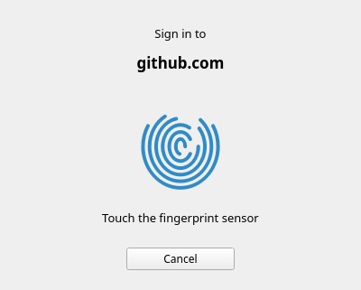

# fprint-tpm-authenticator

A FIDO2 security key for Linux that uses the laptop's fingerprint reader and TPM 2.0.

Browsers see it as a security key. Every registration and sign-in is confirmed with
your fingerprint through `fprintd`, and the signing keys are generated inside the TPM
and never leave it. It works with passkeys and with security-key second factors.

## Features

- CTAP 2.0 over CTAPHID: `getInfo`, `makeCredential`, `getAssertion`, `getNextAssertion`
- ES256 keys bound to the TPM (`fixedTPM`, non-exportable)
- Discoverable credentials (passkeys), up to 100
- A confirmation window for each operation: it names the site, shows the sensor's
  progress and attempts left, and can cancel the request
- Cancellation from the browser
- Privilege separation: a minimal root broker owns `/dev/uhid`, everything else runs
  as the user in a systemd sandbox

Not implemented: clientPIN, U2F/CTAP1, CTAP 2.1 extensions and credential management.

## Requirements

- TPM 2.0 (`/dev/tpmrm0`)
- A fingerprint reader supported by `libfprint`, with an enrolled finger
  (`fprintd-enroll`, then check with `fprintd-verify`)
- systemd, `tpm2-tss`, `libcbor`, OpenSSL, `fprintd`, Qt 6 (`-DFPTA_BUILD_PROMPT=OFF`
  builds without the window and falls back to notifications)

## Installation

### Arch Linux

Each [release](../../releases/latest) includes `fprint-tpm-authenticator-<version>-aur.tar.gz`
with the PKGBUILD:

```sh
mkdir fpta && tar -xzf fprint-tpm-authenticator-*-aur.tar.gz -C fpta
cd fpta && makepkg -si
```

The same PKGBUILD will be published in the AUR, after which an AUR helper such as
`paru` or `yay` installs it with `paru -S fprint-tpm-authenticator`.

### From source

```sh
cmake -S . -B build -DCMAKE_BUILD_TYPE=Release -DCMAKE_INSTALL_PREFIX=/usr \
      -DCMAKE_INSTALL_LIBEXECDIR=lib
cmake --build build
ctest --test-dir build --output-on-failure
sudo cmake --install build
```

On Arch you can instead build a package from the checkout:
`cd packaging/arch && makepkg -si`.

### Enable

```sh
sudo usermod -aG tss "$USER"
sudo modprobe uhid
sudo systemctl enable --now fpta-broker.socket
systemctl --user enable fptad.service
```

Reboot so that the group change applies, then check the installation:

```sh
fpta-hw-check         # registration, sign-in and wrong-finger rejection
fpta-security-check   # permissions, isolation and hostile input
```

Both need `libfido2`; `fpta-security-check` also needs `python`.

Membership in `tss` gives every program you run access to the TPM. Read
[SECURITY.md](SECURITY.md) before enabling it.

## Usage

Use any site that supports security keys or passkeys. When the browser asks,
choose **security key** (not phone or QR code) and touch the fingerprint sensor
when the fpta window appears. No physical USB key is needed.



Browsers show a generic security-key or USB icon: Linux browsers have no built-in
platform authenticator, so fpta is offered as an external key. Sites that accept
only platform authenticators may not offer it.

## How it works

```text
browser ─ hidraw ─ uhid ─ fpta-broker ─ socket ─ fptad ─┬─ TPM 2.0
                          (root)                 (user) └─ fprintd ─ libfprint
```

- **fpta-broker** creates one HID device on the virtual bus with a fixed FIDO report
  descriptor and relays 64-byte reports. It claims no USB vendor or product ID and
  serves only the user active on the seat.
- **fptad** implements CTAPHID and CTAP2, signs with the TPM and asks `fprintd` to
  verify. It drives the **fpta-prompt** window over the session bus; the window
  only displays and cancels, the `fprintd` result alone decides. State lives in `~/.local/share/fpta` and is written atomically.
- A credential ID contains the TPM-wrapped key and an HMAC over the relying party,
  so IDs from other sites or modified IDs are rejected before the TPM is used.

Details: [docs/ARCHITECTURE.md](docs/ARCHITECTURE.md).

## Tested

| | |
| --- | --- |
| Hardware | HP ProBook 450 G8, ELAN `04f3:0c5e` reader, Intel TPM 2.0 |
| System | Arch Linux, fprintd 1.94.5 |
| Browser | Brave 1.100 |

The automated tests run libfido2 against the daemon with a software TPM (`swtpm`) and
a scripted `fprintd` on a private D-Bus, also under AddressSanitizer and
UndefinedBehaviorSanitizer. A libFuzzer target covers the protocol parsers. See
[docs/TESTING.md](docs/TESTING.md). Reports from other hardware and browsers are
welcome.

## Uninstall

```sh
systemctl --user disable --now fptad.service
sudo systemctl disable --now fpta-broker.socket fpta-broker.service
sudo pacman -R fprint-tpm-authenticator
```

Credentials remain in `~/.local/share/fpta`. They become unusable after a TPM clear,
and deleting the directory destroys them. Keep another sign-in method on every
account.

## Related projects

[tpm-fido](https://github.com/psanford/tpm-fido),
[fidorium](https://github.com/edg-l/fidorium),
[cv2-fido](https://github.com/myrtree/cv2-fido),
[Credentials for Linux](https://github.com/linux-credentials).

## License

[GPL-3.0-or-later](LICENSE). See [CONTRIBUTING.md](CONTRIBUTING.md) and
[SECURITY.md](SECURITY.md).
